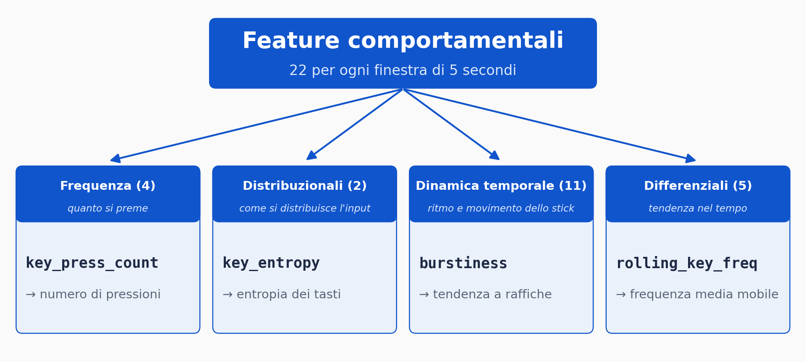
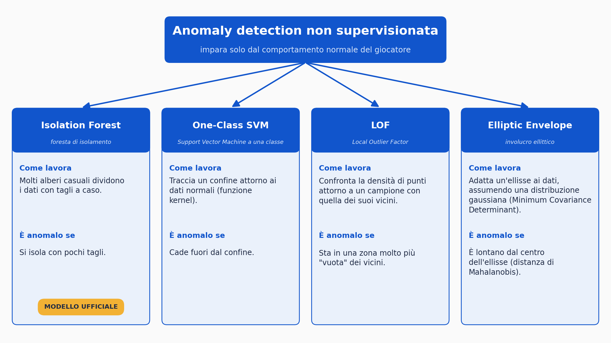

# APATIA — Adattività continua nei videogiochi

> **Stima dello stato del giocatore mediante tecniche di anomaly detection su dati di input**
> Tesi triennale in Informatica — Università degli Studi di Bari Aldo Moro
> Autore: Raffaele Nacci · Relatore: Prof. Pierpaolo Basile · Discussione: 14 ottobre 2026

*English summary below.*

## Di cosa si tratta

La maggior parte dei videogiochi "adattivi" osserva **cosa** sceglie il giocatore (una missione, una risposta a un NPC). Questo progetto osserva **come** gioca, in modo continuo e non invasivo, usando **solo i dati di input del controller** (niente sensori biometrici, niente questionari durante la partita).

**APATIA** è un Metroidvania in Godot 4. Un server Python/FastAPI riceve l'input a finestre di 5 secondi, lo confronta con la baseline personale del giocatore tramite anomaly detection non supervisionata e restituisce un punteggio. Quando lo stress comportamentale accumulato supera una soglia, il gioco cambia: scena diversa, comandi sinistra/destra invertiti e gravità ridotta (il "mondo psichedelico").

> "Stress comportamentale" indica una **deviazione dal comportamento abituale dello stesso giocatore**, non una misura clinica o fisiologica dello stress.

## Demo

🎥 **Video dimostrativo:** _[link da inserire]_

## Cosa contiene questo repository

Il repository pubblica **il sistema di analisi e la tesi**, non il gioco completo.

| Percorso | Contenuto |
|---|---|
| `python/realtime_anomaly_server.py` | Server FastAPI: 22 feature, baseline, quattro modelli, punteggio |
| `python/analyze_session.py` | Analisi di una sessione: grafici, TPR/FPR/latenza, confronto tra soglie |
| `python/evaluate_all_sessions.py` | Metriche aggregate su tutte le sessioni |
| `python/compare_models_all_sessions.py` | TPR/FPR dei quattro modelli |
| `godot/StressMonitor.gd` | Script Godot che cattura l'input e dialoga con il server |
| `docs/Tesi_Nacci_2026.pdf` | Testo completo della tesi (in italiano) |
| `docs/Presentazione_Tesi.pdf` | Slide della discussione |
| `data/README.md` | Formato dei log e note sulla privacy |

**Non inclusi:** il progetto Godot completo (scene, sprite, musica) e i dati grezzi dei partecipanti.

## Come funziona

```
 Godot 4 (client)                         Python / FastAPI (server)
┌──────────────────────┐   POST ogni 5 s  ┌────────────────────────────────┐
│ StressMonitor.gd     │ ───────────────► │ /predict                       │
│  cattura input       │                  │  1. 22 feature per finestra    │
│  (tasti + stick)     │ ◄─────────────── │  2. baseline (globale/per stato)│
│                      │   stress_raw     │  3. Isolation Forest           │
│ Player.gd            │                  │  4. magnitudo × direzione      │
│  integratore a       │                  └────────────────────────────────┘
│  perdita → barra     │
│  soglia → mondo      │
│  psichedelico        │
└──────────────────────┘
```

1. **Finestre.** Ogni 5 s il client invia gli eventi di input; le finestre vuote non vengono inviate.
2. **Feature.** Per ogni finestra si calcolano 22 feature in 4 categorie: frequenza, distribuzionali, dinamica temporale, differenziali.
3. **Baseline personale.** Le prime 12 finestre (circa 60 s) calibrano la baseline globale del giocatore. Per ogni stato di gioco (`idle`, `traversal`, `combat_regular`, `combat_boss`) si addestra una baseline dedicata, congelata dopo 8 finestre.
4. **Punteggio.** Il modello ufficiale è l'**Isolation Forest**. Il punteggio combina la *magnitudo* (quanto ci si discosta dalla norma) con la *direzione* (verso più agitazione o più calma; le deviazioni verso la calma sono attenuate di un fattore 0.3).
5. **Accumulo.** Nel client un integratore a perdita accumula il punteggio (`Θ = clamp(Θ + 3.0·score − 0.3, 0, Θmax)`); al superamento della soglia scatta l'adattamento.

Per confronto, il server calcola in parallelo anche One-Class SVM, Local Outlier Factor ed Elliptic Envelope (quest'ultimo su 5 sole feature).

<p align="center">
  
  
</p>

## Provare il server

Requisiti: Python 3.10 o superiore (testato con 3.11).

```bash
cd python
python -m venv .venv
source .venv/bin/activate        # su Windows: .venv\Scripts\activate
pip install -r ../requirements.txt
uvicorn realtime_anomaly_server:app --host 127.0.0.1 --port 8000
```

Verifica: `http://127.0.0.1:8000/health` risponde `{"status":"ok","calibrated":false}`.
Il server è pensato per un giocatore alla volta (un solo stato globale in memoria). Con il progetto Godot completo, nei primi ~60 s di gioco il server calibra la baseline.

### API del server

| Endpoint | Descrizione |
|---|---|
| `POST /predict` | Riceve una finestra `{"events":[{"type":"key"\|"absolute","event":str,"state":float,"t":float}], "game_state":str}` e restituisce `stress_raw` (1–5), `stress_score_debug`, `top_contributing_feature`, `baseline_used`, `comparison_scores` |
| `POST /log_event` | Registra un evento di gioco (`{"event_name":str,"value":float\|null}`) |
| `POST /reset` | Azzera lo stato e apre nuovi file di log (nuovo giocatore) |
| `GET /health` | Stato del server |

### Protocollo sperimentale

| Fase | Durata | Tasto nel gioco |
|---|---|---|
| Calibrazione | ~60 s | automatica |
| Fase calma | 2 min | **F5** (`calm_start`) |
| Fase frenetica | 2 min | **F6** (`frenetic_start`) |
| Gioco libero | — | — |

Durante il protocollo la barra dello stress resta ferma a 1.0 ("cancello temporale"), così le misure sono pulite; si attiva al termine della fase frenetica.

## Analisi dei dati

Gli script leggono i file `session_*.csv` ed `events_*.csv` da `python/logs/` (non inclusi). Dalla cartella `python/`:

```bash
python analyze_session.py [timestamp]     # grafici e report di una sessione
python evaluate_all_sessions.py           # TPR, FPR, latenza, delta su tutte le sessioni
python compare_models_all_sessions.py     # confronto tra i quattro modelli
```

I risultati vengono salvati in `python/analysis_output/`. La soglia di rilevamento è `DETECTION_THRESHOLD = 0.4`.

## Risultati principali

Dieci partecipanti, protocollo calmo/frenetico (media ± deviazione standard sulle sessioni):

| Metrica | Valore |
|---|---|
| TPR (fase frenetica, punteggio > 0.4) | 81.5% ± 12.6 |
| FPR (fase calma, punteggio > 0.4) | 13.7% ± 11.2 |
| Latenza di rilevamento | 6.70 s ± 5.11 |
| Delta punteggio (frenetica − calma) | 0.550 ± 0.118 |

Confronto tra i quattro modelli (formulazione a 3σ):

| Modello | TPR | FPR |
|---|---|---|
| Isolation Forest | 65.5% | 30.4% |
| One-Class SVM | 62.9% | 34.7% |
| Local Outlier Factor | 44.0% | 25.6% |
| Elliptic Envelope | 72.4% | 28.2% |

Il confronto tra la versione adattiva e quella non adattiva con il questionario GEQ (Core Module) è descritto nel Capitolo 5 della tesi.

## Limiti noti

- Campione ridotto (10 partecipanti, 21–25 finestre per fase): le percentuali sono indicative.
- La soglia 0.4 è stata scelta empiricamente, non con un'analisi ROC.
- La calibrazione assume che i primi 60 s siano comportamento "normale".
- Un solo gioco, di genere metroidvania.
- Il server gestisce un solo giocatore alla volta.

Gli sviluppi futuri sono nel Capitolo 6 della tesi.

## Citazione

Vedi `CITATION.cff`. Esempio:

> Nacci, R. (2026). *APATIA: adattività continua nei videogiochi tramite anomaly detection su dati di input*. Tesi triennale, Università degli Studi di Bari Aldo Moro.

## Licenza

Il codice è rilasciato con licenza MIT (vedi `LICENSE`). Il testo della tesi e le slide sono pubblicati a scopo di documentazione.

---

## English summary

**APATIA (BigEye)** is an adaptive Metroidvania built with Godot 4 that estimates a player's *behavioral state* from controller input alone — no biometric sensors. Every 5 seconds the game sends a window of input events to a Python/FastAPI server, which computes 22 features, compares them against a per-player (and per-game-state) baseline with an unsupervised Isolation Forest, and returns an anomaly score. A leaky integrator accumulates the score; when it crosses a threshold the game switches to a "psychedelic world" (new scene, inverted left/right controls, reduced gravity).

On 10 participants, using a calm/frenetic protocol, the system reaches 81.5% TPR and 13.7% FPR with a mean detection latency of 6.7 s. The thesis also compares four anomaly-detection models and evaluates the player experience with the Game Experience Questionnaire. "Behavioral stress" means deviation from the player's own baseline, not clinical stress.

This repository contains the analysis server, the evaluation scripts, the Godot input-capture script and the thesis (in Italian). The full game project is not included.
